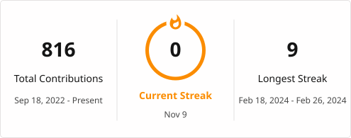

<h1 align="center">Hi 👋, I'm Ankita Ghadge</h1>
<h3 align="center">A Passionate Full-Stack Developer from India</h3>

  

- 💬 Ask me about **Java, Spring Boot, React, DSA**
- 📫 How to reach me **ghadge.ankita197@gmail.com**

<h3 align="left">Connect with me:</h3>

  
  

<h3 align="left">Languages and Tools:</h3>

  
  
  
  
  
  
  

  
  &nbsp;&nbsp;&nbsp;&nbsp;
  

  

